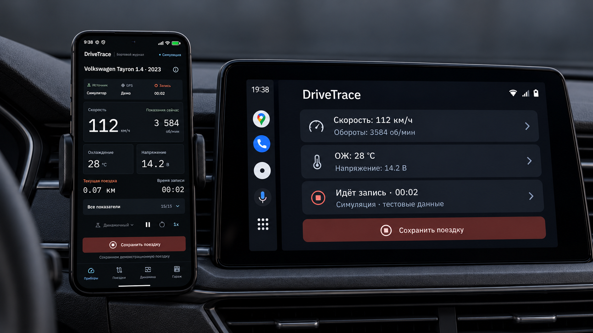
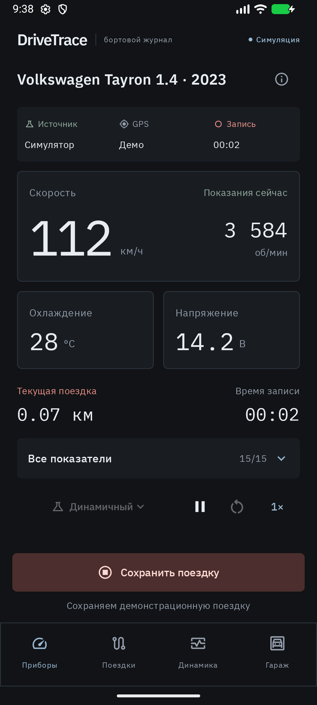
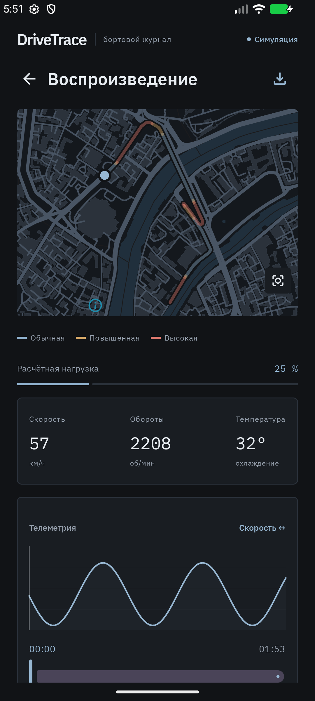
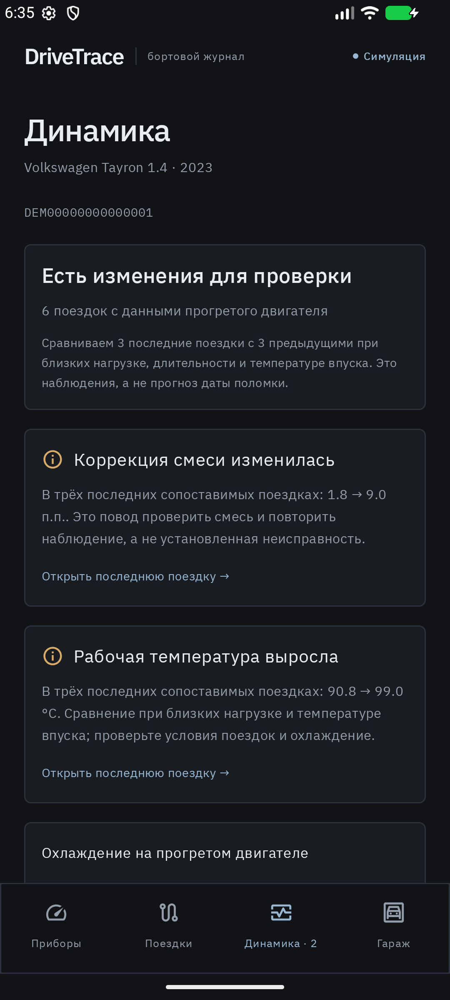

<div align="center">

# DriveTrace

### Ваш автомобиль. Каждая поездка. В деталях.

Бортовой журнал для Android: живые показания OBD-II, запись поездок и маршрут с телеметрией на карте.

**Android 8.0+ · Bluetooth ELM327 · GPS · CSV**

[Возможности](#возможности) · [Интерфейс](#интерфейс) · [Быстрый старт](#быстрый-старт) · [Android Auto](#android-auto) · [Как устроено](#как-устроено) · [Сборка](#сборка)



<sub>На экранах — симуляция. Android Auto — эксперимент в debug-сборке.</sub>

</div>

## Автомобиль расскажет больше

Как прогревался двигатель? На каком участке выросла нагрузка? Как меняются показатели от поездки к поездке?

**DriveTrace превращает поток данных автомобиля в понятную историю.** Подключите Bluetooth-адаптер ELM327, запишите поездку и вернитесь к нужному моменту: маршрут, график и показания связаны общей шкалой времени.

Тёмный интерфейс, крупные цифры и спокойные цветовые акценты помогают быстро находить главное. А встроенный симулятор позволяет познакомиться с приложением даже без автомобиля и адаптера.

## Возможности

| | Что даёт DriveTrace |
| --- | --- |
| **Приборы в реальном времени** | Скорость, обороты, температура охлаждающей жидкости и напряжение — на главном экране. Остальные доступные OBD-II параметры — в панели показателей. |
| **История поездок** | Сохраняйте телеметрию, время и дистанцию. Запись продолжается при свёрнутом приложении и выключенном экране через фоновую службу с уведомлением. |
| **Маршрут с контекстом** | Включите GPS телефона, чтобы увидеть трек на карте, события и цветовую оценку нагрузки на участках пути. |
| **Воспроизведение** | Перематывайте поездку, меняйте скорость воспроизведения, переходите к событиям и изучайте выбранный участок маршрута. |
| **Динамика состояния** | Смотрите графики сохранённых показателей, наблюдения об изменениях между сопоставимыми поездками и полученные коды ошибок ЭБУ. |
| **Гараж по VIN** | Храните историю разных автомобилей раздельно. Если адаптер не прочитал VIN, его можно указать вручную. |
| **Экспорт CSV** | Сохраняйте замеры через системный диалог Android для собственного анализа и графиков. |
| **Демо без оборудования** | Попробуйте город, трассу, динамичную езду и сценарий неисправности. Доступны пауза и ускорение до 5×. |

Набор реальных показателей зависит от автомобиля, ЭБУ и адаптера. Цвет маршрута отражает расчётную оценку нагрузки по оборотам и дросселю; её формула описана в [техническом руководстве](docs/technical-guide.md#карта-и-дорожный-маршрут).

## Интерфейс

<table>
  <tr>
    <td align="center" width="33%"><strong>Главное — перед глазами</strong></td>
    <td align="center" width="33%"><strong>Вернитесь в любой момент</strong></td>
    <td align="center" width="33%"><strong>Замечайте изменения</strong></td>
  </tr>
  <tr>
    <td valign="top"></td>
    <td valign="top"></td>
    <td valign="top"></td>
  </tr>
</table>

Это скриншоты приложения с демонстрационными данными. Внешний вид отдельных экранов может отличаться между сборками.

## Быстрый старт

### Попробовать без автомобиля

1. Установите debug-сборку — [инструкция по сборке ниже](#сборка).
2. Откройте **Настройки → Режим симуляции**, выберите автомобиль.
3. Вернитесь в **Приборы**, нажмите **Найти автомобиль** и подключите виртуальный ELM327.
4. Выберите сценарий и начните запись. Через некоторое время нажмите **Сохранить поездку**.
5. Откройте **Поездки**, выберите запись и исследуйте маршрут, графики и события. CSV доступен по кнопке скачивания в плеере.

### Подключить свой автомобиль

Понадобятся Android-телефон и **ELM327 с Bluetooth Classic**, совместимый с вашим автомобилем.

1. Подключите адаптер к разъёму OBD-II автомобиля и выполните сопряжение в настройках Bluetooth Android.
2. Отключите режим симуляции в DriveTrace, нажмите **Найти автомобиль** и выберите сопряжённый адаптер. Разрешите доступ к Bluetooth по запросу.
3. Для записи маршрута включите **Маршрут по GPS телефона** в настройках и разрешите точную геолокацию. GPS по умолчанию выключен.
4. Начните запись. Сохранить поездку или отключить адаптер можно из приложения и уведомления.

BLE и Wi-Fi адаптеры пока не поддерживаются. Автоматического переподключения после обрыва связи нет.

## Android Auto

**Основные показания — на экране головного устройства.** Экспериментальный экран Android Auto показывает скорость, обороты, температуру охлаждающей жидкости, напряжение и статус записи. С него можно начать запись и сохранить поездку в ту же историю, которая доступна на телефоне.

Интеграция включена **только в debug-сборку** и предназначена для экспериментов с Desktop Head Unit. Это ещё не готовая к публикации в Android Auto функция: категория приложения и проверка хостов требуют отдельного решения. Сопряжение адаптера и настройка выполняются на телефоне.

[Подготовка, запуск и проверка Android Auto →](docs/android-auto.md)

## Ваши поездки остаются у вас

Телеметрия и история хранятся в локальной базе на устройстве. Приложение не загружает записи поездок и CSV на сервер.

Для картографической подложки нужен интернет: поставщик карты получает запросы плиток для выбранной области. Используются MapLibre, OpenFreeMap и данные OpenStreetMap; ключ API не требуется. GPS телефона работает без зависимости от Google Play Services.

## Как устроено

DriveTrace — нативное Android-приложение на Kotlin с одним модулем `app`. Код разделён на модели данных, работу с оборудованием и хранилищем, анализ поездок и интерфейс.

| Компонент | Реализация |
| --- | --- |
| **Интерфейс** | Jetpack Compose и Material 3; состояние экранов передаётся через Kotlin Flow / StateFlow. |
| **Телеметрия** | Общий `Engine`, принадлежащий `Application`: телефон, уведомление и Android Auto работают с одной сессией и записью. Пересоздание Activity не создаёт второй движок. |
| **Подключение** | Bluetooth Classic через RFCOMM / SPP, команды ELM327 и стандартные OBD-II PID. |
| **Данные и настройки** | Room для автомобилей, поездок, замеров, событий и снимков диагностики; DataStore для настроек. |
| **Карта и геолокация** | MapLibre Native, стиль OpenFreeMap, данные OpenStreetMap; координаты телефона через Android LocationManager. |
| **Автомобильный экран** | AndroidX Car App Library в debug-наборе исходников; в release интеграция Android Auto не входит. |

### От адаптера до показаний

При подключении приложение инициализирует ELM327, включает автоматический выбор протокола и определяет поддерживаемые PID. Затем запрашивает VIN, коды неисправностей DTC и доступный стоп-кадр. Скорость, обороты, температуры, давление во впуске, расход воздуха, коррекции смеси и другие параметры отображаются по мере доступности у конкретного ЭБУ.

Интервал опроса настраивается; фактическая частота обновления зависит от количества параметров и скорости ответов адаптера. Скорость берётся из OBD-II, а дистанция рассчитывается по скорости и времени между замерами. GPS используется для положения на карте.

### Запись и качество данных

- **Фоновая работа.** Реальное подключение обслуживает foreground service с постоянным уведомлением и частичной блокировкой сна процессора (`PARTIAL_WAKE_LOCK`). Начать и сохранить запись можно с телефона или экспериментального экрана Android Auto; в уведомлении доступны сохранение и отключение.
- **Время и хранение.** Интервалы измеряются монотонными часами, а замеры сохраняют UTC-время и смещение от начала поездки. Запись в Room выполняется пакетами по восемь кадров; при аварийном завершении могут потеряться последние семь кадров буфера.
- **Проверка GPS.** Для маршрута принимаются координаты не старше 10 секунд с заявленной точностью не хуже 100 м. Пропуски геолокации и разрывы между реальными замерами более 15 секунд не соединяются линией на карте.
- **Экспорт для анализа.** CSV включает VIN, источник и признак симуляции, время, OBD-показатели, координаты, точность и отдельное время GPS. Единицы стабильны: км/ч, км и °C независимо от настроек интерфейса; отсутствующие значения остаются пустыми.

Подробности алгоритмов, структура пакетов и ограничения записи — в [техническом руководстве](docs/technical-guide.md).

## Сборка

Откройте проект в Android Studio. Нужны **JDK 17+**, **Android SDK 36** и устройство или эмулятор с **Android 8.0+ (API 26)**.

```sh
./gradlew :app:assembleDebug
```

Готовый APK: `app/build/outputs/apk/debug/app-debug.apk`.

### Сборка по тегу

При отправке любого тега в GitHub автоматически запускается сборка APK и проверка модульных тестов:

```sh
git tag v0.3.0
git push origin v0.3.0
```

В **Actions → Build tagged APK → Artifacts** доступен архив `DriveTrace-<commit SHA>` с двумя файлами:

- `DriveTrace-<тег>-debug.apk` — APK с debug-подписью, готовый к установке;
- `DriveTrace-<тег>-sources.zip` — исходный код из коммита тега, без истории Git и локальных файлов сборки.

Артефакты хранятся 90 дней. Ключ релизной подписи и секреты для этой сборки не нужны.

Проверки проекта:

```sh
./gradlew :app:testDebugUnitTest :app:lintDebug
```

Локальные тесты проверяют OBD-декодирование и обнаружение параметров, симулятор, GPS, геометрию маршрута и анализ поездок. Инструментальные тесты на устройстве или эмуляторе проверяют фоновую службу, хранение координат, миграцию Room и экран Android Auto:

```sh
./gradlew :app:connectedDebugAndroidTest
```

Для проверок фоновой службы нужен Android 13+. Тесты используют подмену внешнего ELM-транспорта и не заменяют проверку с физическим адаптером.

## Статус проекта

DriveTrace — развивающийся прототип. Уже реализованы Bluetooth Classic ELM327, запись поездок, GPS телефона, воспроизведение, экспорт и симулятор. Работа с физическими адаптерами и ограничения энергосбережения разных телефонов требуют проверки в реальных условиях.

Принудительная остановка приложения или завершение процесса системой может прервать запись; при следующем запуске сохранённая часть получает статус «Прервана». Наблюдения о состоянии автомобиля помогают изучать данные, но не заменяют диагностику и не прогнозируют дату поломки.
